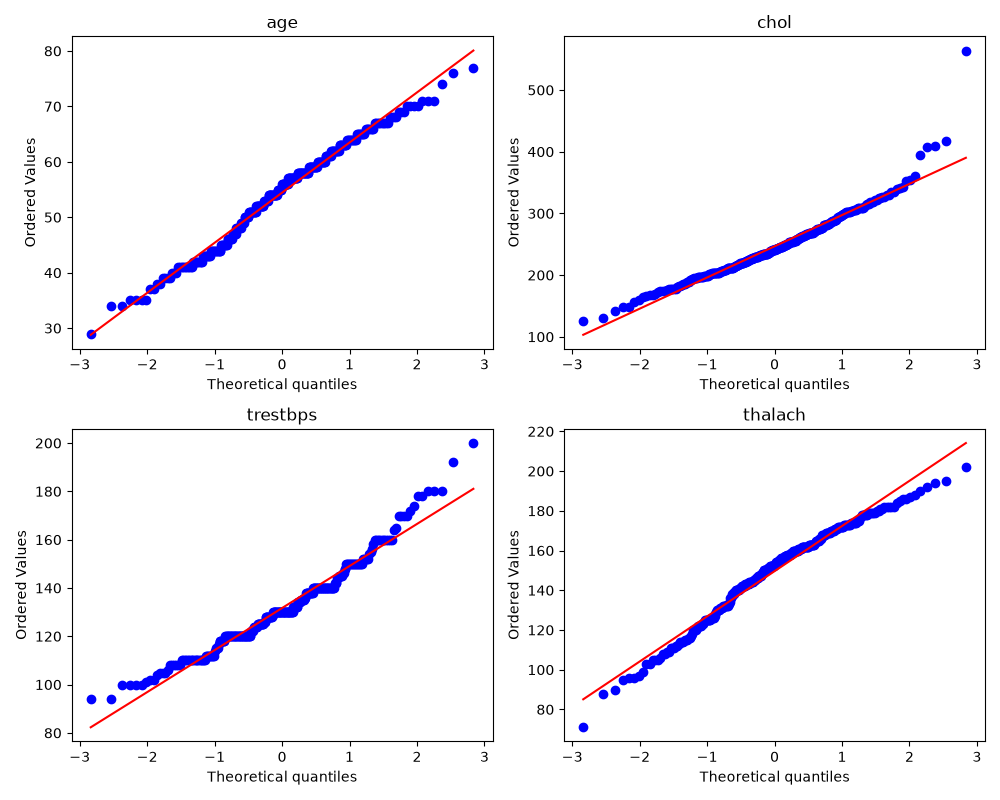
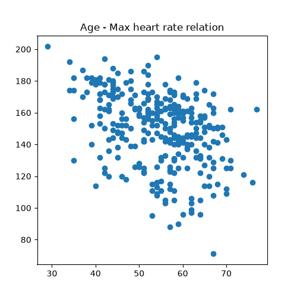

# CSPC - Computer Science for Physics and Chemistry
My coursework repository. Each practical is under PW<n>/Lab <X>/.

## Setup
**Create the environment for a given lab:**

``conda env create -f PW<n>/Lab\ <X>/environment.yml``

``conda activate cspc``

---

## PW1 - Lab A: Reproducible Foundations
**What I built:**
- I determined the difference in speed between the NumPy implementation and plain Python.
- I checked the precision of the program's calculations, comparing them with the formula N_0 * exp(-lambda * time).

**Speed comparison (loop vs NumPy):**
- loop: **3.429 s**
- numpy: **0.0126 s**
- speed-up: **271.8x** faster

**Tests:**  All passed except one with a negative lambda (ValueError).

**Conclusion:**
- For huge loops and scientific calculations, it is preferable to use NumPy rather than common Python tools. The bigger your data gets, the more NumPy is preferred (in my test, it was 272 times faster).

## PW1 - Lab B: Data, Plotting, and Automation
**What the data showed:**
- The observed counts (`decay_observed.csv`) drop from 5000 atoms at t=0 to under 20 by t≈19.5s, following a clearly decreasing curve that is steep at first and flattens out at later times.

**Did it match the analytical law?**
- Yes. Plotted side-by-side with the analytical curve ``N0*exp(-λt)`` *(λ=0.3)*, the observed data traces the same exponential decay shape and overall scale. The small point-to-point noise (visible mainly at large t, where counts are low) is expected statistical scatter, not a mismatch with the law.

**Snakemake pipeline:**
- The `Snakefile` defines a single rule that takes `decay_observed.csv` as input and runs `plot_STUDENT.py` to produce `figure.png`, the observed-vs-analytical comparison figure.

## PW2 - Lab A: Motion from Tracking Data
**Why the acceleration was noisy:**
- This happens because as the step of the independent variable decreases (h → h²; by the definition of the derivative), the small difference between two values gets rounded off by the program, which plays a large role in the final result.

**The mean acceleration I measured:**
- *-8.579687500 m/s²*

**What did integrating back show?**
- Integrating back reduced errors, up to a maximum error of *0.78456 m* (since integration is just a sum).
## PW2 – Lab B: Optimization in Chemistry

### 1. Do the methods agree for a more complicated function?

For a simple function, all three methods can converge to the same minimum. However, for a more complicated W-shaped function, the results depend on the optimization method and the initial starting point.

### 2. Did Newton's method find a minimum or another stationary point?

- **Starting at `x₀ = 0`:** Newton's method converged to `x ≈ 0.17`. Since `g''(x) < 0` at this point, it is a local maximum rather than a minimum.
- **Starting at `x₀ = 2`:** Newton's method converged to `x ≈ 1.13`. Since `g''(x) > 0` at this point, it is a local minimum, but not the global minimum.

**Why?** Newton's method searches for a stationary point where the first derivative is zero. It does not distinguish between minima and maxima, so it can converge to either.

### 3. How did the starting point affect the results?

The three methods approach optimization differently:

- **Gradient descent** iteratively moves in the direction opposite to the gradient. Its result depends on the starting point and can be a local minimum.
- **Newton's method** uses the first and second derivatives to locate stationary points. Its convergence depends on the initial point and the function's curvature.
- **SLSQP (`minimize`)** uses sequential least-squares programming to solve optimization problems, potentially incorporating constraints. It can find a different minimum depending on the function and optimization settings.

### Results for different starting points

| Starting Point | Gradient Descent | Newton's Method | SLSQP (`minimize`) |
|:---:|---|---|---|
| `x₀ = 0` | Global minimum at `x ≈ -1.3` | Local maximum at `x ≈ 0.17` | Global minimum |
| `x₀ = 2` | Local minimum at `x ≈ 1.131` | Local minimum at `x ≈ 1.131` | Global minimum |

### 4. Fitting a reaction rate

The reaction rate constant was estimated by minimizing the squared difference between the measured concentrations and the exponential decay model.

**Fitted rate constant:**

$$
\boxed{k \approx 0.26}
$$

### 5. Chemical equilibrium

At equilibrium, the amounts of hydrogen, iodine, and hydrogen iodide were calculated using the reaction extent and the equilibrium condition.

**Equilibrium amounts:**

- Hydrogen, H₂: **0.336 mol**
- Iodine, I₂: **0.336 mol**
- Hydrogen iodide, HI: **1.328 mol**

Both Newton's method and SLSQP were used to find the equilibrium reaction extent, allowing their results to be compared.

### 6. Titration equivalence point

The equivalence point was determined by finding the titrant volume corresponding to the neutralization condition.

**Equivalence-point volume:**

$$
\boxed{V_{\mathrm{eq}} = 50.0\ \text{mL}}
$$

---

### Conclusion

This lab demonstrated how different optimization methods can produce different results depending on the function, initial guess, and algorithm. It also showed how numerical optimization can be applied to practical chemistry problems, including reaction-rate estimation, chemical equilibrium, and titration analysis.
## PW3: Data, Distributions, Testing, and Causation
### Histogram Shapes

**Age histogram:**
Left-skewed(negatively skewed). Counts rise from *30s*, reach peak from late *50s* to early *60s* (the peak bin is around *60-64*) and drop off at early *70s*.

**Cholesterol histogram:**
Right-skewed(positively skewed). Counts rise from *100*, reach peak at approximately *200-250*, there is a long tail to the right from *330-400* and an outlier around *550*.

**Pressure in rest histogram:**
Right-skewed(positively skewed). Counts rise from *100*, reach peak from *125* to *135* and fall off gradually towards *160-200*(long tail).

**Max heart rate histogram:**
Left-skewed(negatively skewed). Counts rise from *70bpm* (with very few people with such heart rate) and gradually grow from *100bpm* to *160bpm* and then fall off up till *200bpm*.

### Normality check

I used 2 methods to determine the normality of the histograms: ``skewness`` (within +-0.5) and ``q-q plot``.

#### Age: 
Skewness: ``-0.2``

#### Cholesterol: 
Skewness: ``1.12``

#### Pressure in rest: 
Skewness: ``0.7``

#### Max heart rate: 
Skewness: ``-0.53``

#### Conclusion
From skewness and q-q plot we can conclude that **age** histogram can be treated as normally distributed, as it only slightly asymmetrical and **max heart rate** with **Pressure in rest** also can be treated as normally distributed, despite the fact that their skewness is slightly out of the borders (+-0.5), still according to q-q plot we can see very slight shift from the red line. **Cholesterol** histogram is curved upward from the red line according to q-q plot.\

### Max heart of healthy and ill people

As we need to know does the max heart rate actually differ in healthy and ill people, I separated **thalach** histogram in two parts, depending on the target parameter (1 is healthy, 0 is ill). After that I used ``scipy.stats.ttest_ind()`` function to determine p value. Depending on p (if it's 0.05 means are different, if not they are the same) I determined that max heart rate actually differs.

I calculated means and standard errors for those **max heart rate** graphs:
- mean_healthy: *158.37*
- mean_ill: *139.26*
- error_healty: *1.5*
- error_ill: *1.91*

### Relation between age and max heart rate

According to the graph above we can clearly see that as age increases maximum heart rate decreases( of course it also depends on patient's health and genetics) => ``age ~ 1/thalach``

### Chemical-exposure 

#### The naive analysis
According to Pearson and Spearman rho values **cadmium** is strongly related with malignancy ``(r ~ 0.9)``

#### Deep look
If we will restrict our pollution index (between 40 and 60) then we will observe that the relation of cadmium with malignancy also decreases ``r = 0.013``, so we can say that cause of cadmium is pollution index and cause of malignancy is also pollution. Cadmium only looked "guilty" the real cause is pollution index.(For age all r are almost 0 => there is no relation).

#### How balanced target category is?
According to my code ``54.12%`` of people are healthy and ``45.87%`` are ill. <code>H (entropy) = −(0.541 log₂ 0.541 + 0.459 log₂ 0.459) = 0.995 bits</code>. So it is almost perfectly balanced.