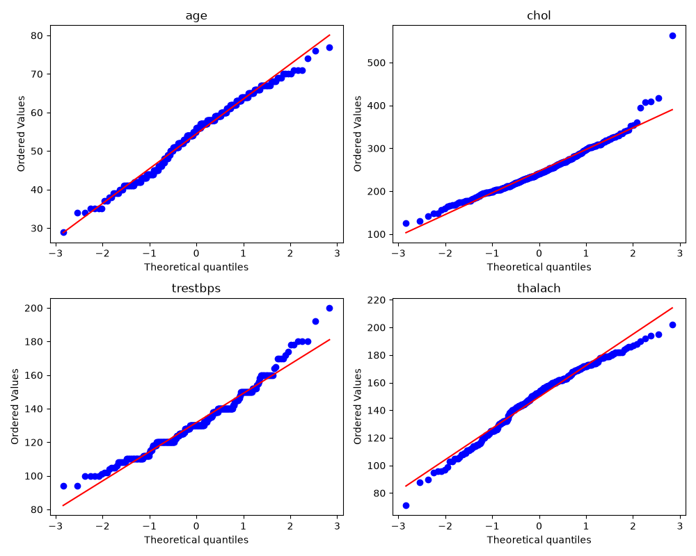
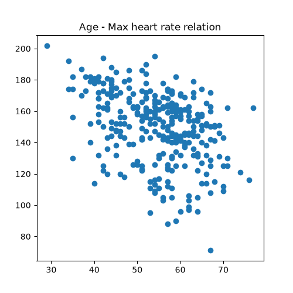

# CSPC - Computer Science for Physics and Chemistry
My coursework repository. Each practical is under PW<n>/Lab <X>/.

## Setup
**Create the environment for a given lab:**

``conda env create -f PW<n>/Lab\ <X>/environment.yml``

``conda activate cspc``

---

## PW1 - Lab A: Reproducible Foundations
**What I built:**
- I determined the difference in speed between the NumPy implementation and plain Python.
- I checked the precision of the program's calculations, comparing them with the formula N_0 * exp(-lambda * time).

**Speed comparison (loop vs NumPy):**
- loop: **3.429 s**
- numpy: **0.0126 s**
- speed-up: **271.8x** faster

**Tests:**  All passed except one with a negative lambda (ValueError).

**Conclusion:**
- For huge loops and scientific calculations, it is preferable to use NumPy rather than common Python tools. The bigger your data gets, the more NumPy is preferred (in my test, it was 272 times faster).

## PW1 - Lab B: Data, Plotting, and Automation
**What the data showed:**
- The observed counts (`decay_observed.csv`) drop from 5000 atoms at t=0 to under 20 by t≈19.5s, following a clearly decreasing curve that is steep at first and flattens out at later times.

**Did it match the analytical law?**
- Yes. Plotted side-by-side with the analytical curve ``N0*exp(-λt)`` *(λ=0.3)*, the observed data traces the same exponential decay shape and overall scale. The small point-to-point noise (visible mainly at large t, where counts are low) is expected statistical scatter, not a mismatch with the law.

**Snakemake pipeline:**
- The `Snakefile` defines a single rule that takes `decay_observed.csv` as input and runs `plot_STUDENT.py` to produce `figure.png`, the observed-vs-analytical comparison figure.

## PW2 - Lab A: Motion from Tracking Data
**Why the acceleration was noisy:**
- This happens because as the step of the independent variable decreases (h → h²; by the definition of the derivative), the small difference between two values gets rounded off by the program, which plays a large role in the final result.

**The mean acceleration I measured:**
- *-8.579687500 m/s²*

**What did integrating back show?**
- Integrating back reduced errors, up to a maximum error of *0.78456 m* (since integration is just a sum).
## PW2 – Lab B: Optimization in Chemistry

### 1. Do the methods agree for a more complicated function?
<hr>

For a simple function, all three methods can converge to the same minimum. However, for a more complicated W-shaped function, the results depend on the optimization method and the initial starting point.

### 2. Did Newton's method find a minimum or another stationary point?
<hr>

- **Starting at `x₀ = 0`:** Newton's method converged to `x ≈ 0.17`. Since `g''(x) < 0` at this point, it is a local maximum rather than a minimum.
- **Starting at `x₀ = 2`:** Newton's method converged to `x ≈ 1.13`. Since `g''(x) > 0` at this point, it is a local minimum, but not the global minimum.

**Why?** Newton's method searches for a stationary point where the first derivative is zero. It does not distinguish between minima and maxima, so it can converge to either.

### 3. How did the starting point affect the results?
<hr>

The three methods approach optimization differently:

- **Gradient descent** iteratively moves in the direction opposite to the gradient. Its result depends on the starting point and can be a local minimum.
- **Newton's method** uses the first and second derivatives to locate stationary points. Its convergence depends on the initial point and the function's curvature.
- **SLSQP (`minimize`)** uses sequential least-squares programming to solve optimization problems, potentially incorporating constraints. It can find a different minimum depending on the function and optimization settings.

### Results for different starting points

| Starting Point | Gradient Descent | Newton's Method | SLSQP (`minimize`) |
|:---:|---|---|---|
| `x₀ = 0` | Global minimum at `x ≈ -1.3` | Local maximum at `x ≈ 0.17` | Global minimum |
| `x₀ = 2` | Local minimum at `x ≈ 1.131` | Local minimum at `x ≈ 1.131` | Global minimum |

### 4. Fitting a reaction rate
<hr>

The reaction rate constant was estimated by minimizing the squared difference between the measured concentrations and the exponential decay model.

**Fitted rate constant:**

$$
\boxed{k \approx 0.26}
$$

### 5. Chemical equilibrium
<hr>

At equilibrium, the amounts of hydrogen, iodine, and hydrogen iodide were calculated using the reaction extent and the equilibrium condition.

**Equilibrium amounts:**

- Hydrogen, H₂: **0.336 mol**
- Iodine, I₂: **0.336 mol**
- Hydrogen iodide, HI: **1.328 mol**

Both Newton's method and SLSQP were used to find the equilibrium reaction extent, allowing their results to be compared.

### 6. Titration equivalence point
<hr>

The equivalence point was determined by finding the titrant volume corresponding to the neutralization condition.

**Equivalence-point volume:**

$$
\boxed{V_{\mathrm{eq}} = 50.0\ \text{mL}}
$$

---

### Conclusion
<hr>

This lab demonstrated how different optimization methods can produce different results depending on the function, initial guess, and algorithm. It also showed how numerical optimization can be applied to practical chemistry problems, including reaction-rate estimation, chemical equilibrium, and titration analysis.
## PW3: Data, Distributions, Testing, and Causation
### Histogram Shapes
<hr>

**Age histogram:**
Left-skewed(negatively skewed). Counts rise from *30s*, reach peak from late *50s* to early *60s* (the peak bin is around *60-64*) and drop off at early *70s*.

**Cholesterol histogram:**
Right-skewed(positively skewed). Counts rise from *100*, reach peak at approximately *200-250*, there is a long tail to the right from *330-400* and an outlier around *550*.

**Pressure in rest histogram:**
Right-skewed(positively skewed). Counts rise from *100*, reach peak from *125* to *135* and fall off gradually towards *160-200*(long tail).

**Max heart rate histogram:**
Left-skewed(negatively skewed). Counts rise from *70bpm* (with very few people with such heart rate) and gradually grow from *100bpm* to *160bpm* and then fall off up till *200bpm*.

### Normality check
<hr>

I used 2 methods to determine the normality of the histograms: ``skewness`` (within +-0.5) and ``q-q plot``.

#### Age: 
Skewness: ``-0.2``

#### Cholesterol: 
Skewness: ``1.12``

#### Pressure in rest: 
Skewness: ``0.7``

#### Max heart rate: 
Skewness: ``-0.53``



#### Conclusion
From skewness and q-q plot we can conclude that **age** histogram can be treated as normally distributed, as it only slightly asymmetrical and **max heart rate** with **Pressure in rest** also can be treated as normally distributed, despite the fact that their skewness is slightly out of the borders (+-0.5), still according to q-q plot we can see very slight shift from the red line. **Cholesterol** histogram is curved upward from the red line according to q-q plot.\

### Max heart of healthy and ill people
<hr>

As we need to know does the max heart rate actually differ in healthy and ill people, I separated **thalach** histogram in two parts, depending on the target parameter (1 is healthy, 0 is ill). After that I used ``scipy.stats.ttest_ind()`` function to determine p value. Depending on p (if it's 0.05 means are different, if not they are the same) I determined that max heart rate actually differs.

I calculated means and standard errors for those **max heart rate** graphs:
- mean_healthy: *158.37*
- mean_ill: *139.26*
- error_healty: *1.5*
- error_ill: *1.91*

### Relation between age and max heart rate
<hr>



According to the graph above we can clearly see that as age increases maximum heart rate decreases( of course it also depends on patient's health and genetics) => ``age ~ 1/thalach``

### Chemical-exposure 
<hr>

#### The naive analysis
According to Pearson and Spearman rho values **cadmium** is strongly related with malignancy ``(r ~ 0.9)``

#### Deep look
If we will restrict our pollution index (between 40 and 60) then we will observe that the relation of cadmium with malignancy also decreases ``r = 0.013``, so we can say that cause of cadmium is pollution index and cause of malignancy is also pollution. Cadmium only looked "guilty" the real cause is pollution index.(For age all r are almost 0 => there is no relation).

#### How balanced target category is?
According to my code ``54.12%`` of people are healthy and ``45.87%`` are ill. <code>H <sub>(entropy)</sub> = −(0.541 log₂ 0.541 + 0.459 log₂ 0.459) = 0.995 bits</code>. So it is almost perfectly balanced.

## PW4: Machine Learning: Supervised and Unsupervised
### Units for each variable.
| Variable Name | Units |
|:---| ---:|
| Cement | kg/m^3 |
| Slag | kg/m^3 |
| Ash | kg/m^3 |
| Water | kg/m^3 |
| Superplastic | kg/m^3 |
| coarse_agg | kg/m^3 |
| fine_agg | kg/m^3 |
| Age | day |
| strngth | MPa |
### Why we should avoid duplicates?
Only one of the same values will be useful for our program, the others will only take memory and time without any effect to the program.
### Different numerical scales.
coarse_agg (mean about 974) and fine_agg (about 773) are far larger than superplastic (about 6), and cement (about 279) is also large.
### Strength against cement and against age.
**Strength vs cement**. There is a positive but noisy relationship. More cement per cubic metre tends to give stronger concrete. At any given cement content the spread is very wide, so cement alone explains only part of the variation. The other ingredients and the age clearly matter. Above about 400 kg/m³ the points become sparser and the trend looks flatter and more scattered.

**Strength vs age**. The relationship is clearly non-linear. Strength rises steeply early on and reaches higher values around 56 days. After roughly 3 months the points show no clear upward trend. The averages at later ages jump around. That is not concrete weakening: the few mixes tested at those ages are different mixes, so composition is mixed in with age. The data is also concentrated at discrete ages, mostly under 100 days, with few long-age samples. Transformation such as log(age) or a model that handles non-linearity would suit this graph better than linear functions.

### Linear Regression

A Linear Regression model from Scikit-learn was trained to predict concrete compressive strength using 8 input features.

#### Fitted equation

The resulting regression equation is:

$$
\begin{aligned}
\hat{S} = &-28.82355 + 0.11899C + 0.10854Sl \
&+ 0.08215Ash - 0.13528W + 0.31057SP \
&+ 0.01787CA + 0.02410FA + 0.11644Age
\end{aligned}
$$

Where:
- S = predicted concrete strength (MPa)
- C = cement (kg/m³)
- Sl = blast furnace slag (kg/m³)
- Ash = fly ash (kg/m³)
- W = water (kg/m³)
- SP = superplasticizer (kg/m³)
- CA = coarse aggregate (kg/m³)
- FA = fine aggregate (kg/m³)
- Age = concrete age (days)

The coefficients of the ingredient features have units of MPa per kg/m³, while the age coefficient has units of MPa per day.

#### Model evaluation

The model was evaluated using RMSE, MAE, R² and Adjusted R².

| Metric | Result |
|---|---:|
| Train RMSE | 10.519 |
| Test RMSE | 9.796 |
| Test MAE | 7.746 |
| Train R² | 0.611 |
| Train Adjusted R² | 0.607 |
| Test R² | 0.628 |

The training and testing RMSE values are relatively close, suggesting that the model does not show significant overfitting.

The test R² of 0.628 indicates that the model explains approximately 62.8% of the variation in concrete strength on the testing set.

#### Residual analysis

Residuals were calculated as:

$$
Residual = y_{true} - y_{predicted}
$$

They were plotted against concrete age using a logarithmic x-axis.

The residual plot shows a systematic, non-random pattern:

- At very young ages and older ages, residuals tend to be negative.
- At intermediate ages, residuals tend to be positive.

This suggests that the linear model does not fully capture the relationship between concrete age and compressive strength.

The model may be missing important nonlinear relationships or other underlying patterns in the data.

Therefore, polynomial regression of age may improve the model.

### A5. Polynomial Regression.
Four polynomial degrees were tested: 1, 2, 3 and 4. Each model used PolynomialFeatures, StandardScaler and LinearRegression in a pipeline.


#### Results

| Degree | Features | Train RMSE | Test RMSE | Train R² | Adjusted R² | Test R² |
|---|---:|---:|---:|---:|---:|---:|
| 1 | 8 | 10.5188 | 9.7965 | 0.6105 | 0.6067 | 0.6276 |
| 2 | 44 | 7.2871 | 7.4554 | 0.8131 | 0.8025 | 0.7843 |
| 3 | 164 | 4.4254 | 6.3486 | 0.9311 | 0.9139 | 0.8436 |
| 4 | 494 | 2.1797 | 82.9980 | 0.9833 | 0.9582 | -25.7337 |

#### Model Selection

Degree 3 was selected because it provides a good balance between training and testing performance.

It achieves a test R² of 0.8813 and a test RMSE of 5.95 MPa.

### Overfitting at Degree 4

At degree 4, the number of features increases to 494, compared with 824 training samples.

The training RMSE becomes very small, but the test RMSE increases dramatically and the test R² becomes strongly negative.

This indicates severe overfitting: the model fits the training data extremely well but fails to generalize to unseen data.

---

### A6. Classification: KNN and Decision Tree

#### Results

| K | train acc | test acc |
|---:|---:|---:|
| 1 | 0.9975 | 0.8308 |
| 3 | 0.9341 | 0.8010 |
| 5 | 0.9067 | 0.8159 |
| 7 | 0.8930 | 0.8358 |
| **15** | **0.8483** | **0.8259** |
| 25 | 0.8408 | 0.8060 |
| 51 | 0.8047 | 0.7811 |
| 101 | 0.7575 | 0.7363 |


K = 15 was selected as a compromise between training and testing performance.

K = 1 achieves very high training accuracy but has a larger train-test gap, indicating possible overfitting.

**With and without scaler (K = 15, test accuracy):** 0.8259 with `StandardScaler`, 0.8209 without. The difference is 0.005, far below the spread below, so on this dataset I cannot claim that scaling helps. I still keep the scaler: KNN compares raw distances, and `coarse_agg` and `age` are much larger than `superplastic`, so without scaling they decide the distance only by units.

**Five splits (`random_state` = 0..4), K = 15, scaled:**

| random_state | 0 | 1 | 2 | 3 | 4 |
|---|---:|---:|---:|---:|---:|
| test accuracy | 0.8010 | 0.8109 | 0.8010 | 0.8308 | 0.7662 |

Mean 0.802, standard deviation 0.023, range 0.065. **Consequence:** differences below 0.03 in one test split are noise. This covers the choice between K = 5, 7, 15 and the scaler/no-scaler difference. What is meaningful: K = 1 vs large train–test gaps, and K ≥ 51 (clearly lower).

### Decision tree sweep (`criterion="entropy"`) — `results/A6_tree_sweep.png`

| max_depth | leaves | train acc | test acc | gap |
|---:|---:|---:|---:|---:|
| 1 | 2 | 0.7550 | 0.7015 | 0.054 |
| 2 | 4 | 0.7550 | 0.7015 | 0.054 |
| 3 | 8 | 0.8396 | 0.7960 | 0.044 |
| **4** | **16** | **0.8694** | **0.8259** | **0.044** |
| 5 | 26 | 0.8893 | 0.8458 | 0.044 |
| 6 | 38 | 0.9303 | 0.8408 | 0.090 |
| 8 | 61 | 0.9726 | 0.8557 | 0.117 |
| None (real depth 11) | 80 | 0.9975 | 0.8806 | 0.117 |


**Gap vs depth.** The gap stays about 0.04–0.05 up to depth 5, then grows to 0.09 (depth 6) and 0.12 (depth 8 and greater) as the tree starts fitting individual training rows . Depths 1–2 are identical: the second split does not change the predictions.

**Choice: max_depth = 4** (16 leaves). It can be read and checked by an engineer, while the unlimited tree has 80 leaves and is unreadable. Depth 5 (26 leaves, 0.846) is a reasonable alternative if accuracy matters more than readability.

**Top two levels of the depth-4 tree:**

```
|--- age <= 42.00
|   |--- cement <= 257.70
|   |   |--- water <= 156.20 ...
|   |   |--- water >  156.20 ...
|   |--- cement >  257.70
|   |   |--- superplastic <= 0.95 ...
|   |   |--- superplastic >  0.95 ...
|--- age >  42.00
|   |--- superplastic <= 6.45
|   |   |--- fine_agg <= 749.55 ...
|   |   |--- fine_agg >  749.55 ...
|   |--- superplastic >  6.45
|   |   |--- cement <= 203.35 ...
|   |   |--- cement >  203.35 ...
```

**Root question: "is `age` ≤ 42 days?"** It makes physical sense: cement hydration continues with time, so young samples (≤ 42 days) rarely reach 40 MPa and old ones reach it often. 

## A7. The metrics that matter (`results/A_metrics.csv`)

Test set, 201 rows (72 real class 1, 129 real class 0):

| model | TP | FP | FN | TN | accuracy | precision | recall | F1 |
|---|---:|---:|---:|---:|---:|---:|---:|---:|
| KNN K=15 (scaled), t=0.5 | 48 | 11 | 24 | 118 | 0.8259 | 0.8136 | 0.6667 | 0.7328 |
| Tree depth=4, t=0.5 | 58 | 21 | 14 | 108 | 0.8259 | 0.7342 | 0.8056 | 0.7682 |
| KNN K=15, **t=0.7** (final) | 32 | 4 | 40 | 125 | 0.7811 | 0.8889 | 0.4444 | 0.5926 |

Both models have the same accuracy but very different mistakes: the KNN is more precise, the tree finds more strong mixes (higher recall).

**Which mistake is dangerous?** A **false positive (FP)**: the model says "reaches 40 MPa" but the concrete is weaker, so a structure may be built with concrete that is too weak. A false negative only means that a good mix is rejected. The metric that controls FP is **precision** = TP/(TP+FP): the share of "OK" verdicts that are really OK.

**Thresholds for KNN (K = 15):**

| threshold | TP | FP | FN | TN | precision | recall |
|---:|---:|---:|---:|---:|---:|---:|
| 0.3 | 65 | 30 | 7 | 99 | 0.6842 | 0.9028 |
| 0.5 | 48 | 11 | 24 | 118 | 0.8136 | 0.6667 |
| **0.7** | 32 | 4 | 40 | 125 | 0.8889 | 0.4444 |
| 0.9 | 9 | 0 | 63 | 129 | 1.0000 | 0.1250 |

**Chosen threshold: 0.7.** Since FP is the dangerous error, I move the threshold up: FP drops from 11 to 4 and precision rises to 0.89. Threshold 0.9 gives no FP on this test set but accepts only 9 of 72 good mixes, so the model would be useless in practice, and zero FP on 201 rows does not prove zero risk. (With K = 15 the predicted probability takes values k/15, so t = 0.7 means "at least 11 of the 15 neighbours are class 1".)

**What a safer threshold costs:** recall. From t = 0.5 to 0.7 recall falls from 0.67 to 0.44: 40 of the 72 truly good mixes are rejected (FN 24 → 40) and accuracy drops from 0.826 to 0.781. In practice this means over-designing, adding cement or making extra tests for the rejected mixes.

## A8. Which ingredients matter? (`results/A8_importance.png`)

Raw and standardised coefficients come from the regression on `strength`; tree and permutation importances are for the classifiers of A6.

| input | raw coef (MPa per unit) | standardised coef (MPa per std) | tree importance | perm. KNN | perm. tree |
|---|---:|---:|---:|---:|---:|
| cement | 0.1167 | **12.12** | 0.2895 | **0.1366** | **0.1932** |
| slag | 0.0981 | 8.44 | 0.0199 | 0.0329 | 0.0000 |
| ash | 0.0846 | 5.44 | 0.0000 | −0.0097 | 0.0000 |
| water | −0.1314 | −2.83 | 0.0371 | 0.0696 | 0.0098 |
| superplastic | 0.3315 | 1.97 | 0.1929 | 0.0319 | 0.1706 |
| coarse_agg | 0.0155 | 1.20 | 0.0080 | 0.0235 | 0.0000 |
| fine_agg | 0.0206 | 1.67 | 0.0861 | 0.0443 | 0.0663 |
| age | 0.1106 | 6.89 | **0.3666** | 0.1289 | 0.1338 |


**Raw vs standardised ranking (by absolute value).**
- Raw: superplastic, water, cement, age, slag, ash, fine_agg, coarse_agg.
- Standardised: cement, slag, age, ash, water, superplastic, fine_agg, coarse_agg.

Raw coefficients have different units (MPa per kg/m³, MPa per day), so their size depends on the unit and on how widely each input varies. `superplastic` has the largest raw coefficient (0.33) simply because it only varies over a few kg/m³, so one unit is a big change; per standard deviation it is almost the smallest effect (1.97). The standardised coefficients measure the effect of one typical change of each input and can be compared.

**Do methods agree?** Partly. **Cement and age** are in the top three of all four views (standardised coefficients: cement, slag, age; tree: age, cement, superplastic; permutation KNN: cement, age, water; permutation tree: cement, superplastic, age). The third place is not stable (slag, superplastic or water). `ash` is the least useful for the classifiers (0 for the tree, slightly negative for KNN, which is just noise).

**Consistency with the engineers' rule (water/cement ratio and age).** Age and cement agree well. Water is only moderately important: 3rd for the KNN permutation, but 5th for the tree and for the standardised coefficients. A reason is that the rule is about the *ratio* water/cement, which none of these views uses directly, and that the inputs are correlated (e.g. superplasticiser is added in mixes with less water), so the importance of one input is shared with, or hidden behind, others. So the ranking is consistent for age and cement and only partly for water.

**Can high importance tell that changing the ingredient would change strength?** No. Importance says how much the *model relies* on an input to predict on this dataset; it is not an effect of an intervention. The data are observational laboratory recipes (as in PW3: correlation is not causation): inputs were changed together, so a high importance may come from a correlated ingredient. Permutation also shuffles one column independently, which creates mixes that never occur in practice.

## Bonus — let physics choose the features

Same split as A4/A5 , test R²:

| model | features | test R² |
|---|---:|---:|
| polynomial degree 1 (plain linear) | 8 | 0.5802 |
| polynomial degree 2 | 44 | 0.7686 |
| polynomial degree 3 | 164 | 0.8813 |
| polynomial degree 4 | 494 | −4.2061 |
| linear, `log(age)` instead of `age` | 8 | 0.8037 |
| linear, `log(age)` and `w/b` instead of `water` | 8 | 0.8064 |

Replacing `age` by `log(age)` alone raises R² from 0.58 to 0.80 with the same 8 features, more than a degree-2 polynomial with 44 features (0.77). The extra gain from `w/b` is small here (+0.003). Degree 3 is still better (0.88), but it needs 164 coefficients for 804 rows, and degree 4 breaks down (494 features for 804 rows, R² < 0). **Conclusion:** a single piece of domain knowledge gives most of the gain of a flexible model with a few features, a model that can still be explained, while pure flexibility needs many parameters and becomes dangerous when the number of features approaches the number of rows.

---

# SESSION B

## B1. Load and hide the labels

The data are the UCI Wine data: 178 wines from the same region of Italy, from three cultivars (59, 71 and 48 wines). Each wine has 13 values from chemical analysis: alcohol, malic acid, ash, alcalinity of ash, magnesium, total phenols, flavanoids, nonflavanoid phenols, proanthocyanins, colour intensity, hue, OD280/OD315 of diluted wines, proline. The cultivar is kept aside in `cultivar` (until B6).

**Largest** range and standard deviation: `proline` (std 314.9, range 1402, values 278–1680), then `magnesium` (std 14.3, range 92) and `alcalinity_of_ash` (std 3.3, range 19.4). **Smallest:** `nonflavanoid_phenols` (std 0.124, range 0.53), then `hue` (std 0.229) and `ash` (std 0.274). The scales differ by a factor of about 2500 between proline and nonflavanoid phenols. 

## B2. PCA on the raw data

PC1 explains **99.81 %** of the variance (PC2: 0.17 %). Its loadings, sorted by size: proline **0.9998**, magnesium 0.0179, alcalinity_of_ash −0.0047, all others below 0.003 in absolute value.

**Why proline dominates:** PCA looks for the direction of largest variance and does not rescale. Proline has a standard deviation of 315 (variance ~10⁵), while the next largest (magnesium) has a variance of about 200 and all others are far smaller, so a single column makes up almost all the variance, and PC1 is just "proline". **I would not accept this PC1 as the main chemical difference between the wines:** it only tells us which column has the biggest numbers.

## B3. Scale, then PCA

After `StandardScaler` every column has mean 0 and standard deviation 1. 

| PC | 1 | 2 | 3 | 4 | 5 | 6 | 7 | 8 | 9 | 10 | 11 | 12 | 13 |
|---|---:|---:|---:|---:|---:|---:|---:|---:|---:|---:|---:|---:|---:|
| explained | .362 | .192 | .111 | .071 | .066 | .049 | .042 | .027 | .022 | .019 | .017 | .013 | .008 |
| cumulative | .362 | .554 | .665 | .736 | .802 | .851 | .893 | .920 | .942 | .962 | .979 | .992 | 1.0 |


**90 % of the variance needs 8 components** (7 give 89.3 %). **The PC1–PC2 plane keeps 55.4 %.**

**Loadings**:

| | PC1 positive | PC1 negative | PC2 positive | PC2 negative |
|---|---|---|---|---|
| strongest | flavanoids .42, total phenols .40, OD280 .38, proanthocyanins .31, hue .30, proline .29 | nonflavanoid phenols −.30, malic acid −.25, alcalinity of ash −.24 | colour intensity .53, alcohol .48, proline .37, ash .32, magnesium .30 | hue −.28, OD280 −.16 |

- **PC1** separates wines rich in phenolic compounds (flavanoids, total phenols, proanthocyanins, high OD280) from wines with more non-flavanoid phenols, malic acid and alkaline ash.
- **PC2** separates strongly coloured, alcoholic wines (high colour intensity, alcohol, proline) from pale wines with a higher hue and value OD280.


**By eye I would guess 3 groups:** one on the left, one at the bottom, one on the right.

## B4. K-Means

**(a)** Inertia for k = 3, `n_init=1`, `random_state` = 0..7: 1277.93, 1278.76, 1277.93, 1277.93, 1279.97, 1278.76, 1282.46, 1278.76. The values differ because K-Means starts from random centres and only finds a local minimum, so different starts end in different solutions (three runs reached 1277.93, three 1278.76, and two worse ones). `n_init=10` runs the algorithm 10 times from different starts and keeps the run with the lowest inertia, which gives 1277.93 (the best of the values above).

**(b)** Inertia for k = 1..10 :

| k | 1 | 2 | 3 | 4 | 5 | 6 | 7 | 8 | 9 | 10 |
|---|---:|---:|---:|---:|---:|---:|---:|---:|---:|---:|
| inertia | 2314 | 1659 | 1278 | 1181 | 1110 | 1045 | 996 | 945 | 913 | 865 |


**Choice: k = 3.** The curve drops by 655 and 381 for k = 1→2 and 2→3, then only by 97 and 70 or fewer for each further step; the bend (elbow) is at k = 3. It also agrees with the three groups seen in B3. **Why not minimise inertia?** Inertia always decreases when k grows and it reaches 0 when k = number of wines (each wine is its own cluster). The minimum is therefore a useless answer, so k has to be chosen where the improvement is not large.

## B5. What are the clusters? (k = 3, scaled data)

Cluster sizes: **65, 51, 62**. Centres in real units, main differences:

| | cluster 0 (65) | cluster 1 (51) | cluster 2 (62) |
|---|---:|---:|---:|
| alcohol | 12.25 | 13.13 | 13.68 |
| malic_acid | 1.90 | 3.31 | 2.00 |
| alcalinity_of_ash | 20.06 | 21.24 | 17.46 |
| total_phenols | 2.25 | 1.68 | 2.85 |
| flavanoids | 2.05 | 0.82 | 3.00 |
| color_intensity | 2.97 | 7.23 | 5.45 |
| hue | 1.06 | 0.69 | 1.07 |
| od280/od315 | 2.80 | 1.70 | 3.16 |
| proline | 510 | 619 | 1100 |

(Not shown: magnesium, ash, proanthocyanins and nonflavanoid phenols differ less.)

- **Cluster 0:** light wines with the lowest alcohol (12.3) and lowest proline (510), weak colour (3.0) and medium phenols.
- **Cluster 1:** wines with the highest malic acid (3.3) and colour intensity (7.2), lowest flavanoids (0.8), phenols and hue, and the lowest OD280.
- **Cluster 2:** the strongest alcoholic and phenolic wines: highest proline (1100), alcohol (13.7), flavanoids (3.0), total phenols and OD280, with the lowest alcalinity of ash.


## B6. The reveal (`results/B_agreement.csv`)

| version | agreement |
|---|---:|
| (i) K-Means on scaled data | **0.9663** |
| (ii) K-Means on raw data | 0.7022 |
| (iii) K-Means on PC1+PC2 of scaled data | **0.9663** |

Crosstab (rows: true cultivar; columns: cluster):

| (i) scaled | c0 | c1 | c2 | | (ii) raw | c0 | c1 | c2 | | (iii) 2 PCs | c0 | c1 | c2 |
|---|---:|---:|---:|---|---|---:|---:|---:|---|---|---:|---:|---:|
| cultivar 0 | 0 | 0 | 59 | | cultivar 0 | 0 | 46 | 13 | | cultivar 0 | 0 | 59 | 0 |
| cultivar 1 | 65 | 3 | 3 | | cultivar 1 | 50 | 1 | 20 | | cultivar 1 | 65 | 5 | 1 |
| cultivar 2 | 0 | 48 | 0 | | cultivar 2 | 19 | 0 | 29 | | cultivar 2 | 0 | 0 | 48 |

(Cluster numbers are arbitrary: in (i), cluster 2 ≈ cultivar 0, cluster 0 ≈ cultivar 1, cluster 1 ≈ cultivar 2.)

- **(i) 0.966 = 172 of 178 wines.** After scaling all 13 measurements count equally, and the chemistry recovers the cultivars almost completely; only 6 wines of cultivar 1 are in the wrong group.
- **(ii) 0.702.** Without scaling K-Means uses Euclidean distance, which is dominated by the column with the largest numbers: proline (std 315) and a bit of magnesium (B1, B2). K-Means then effectively clusters the wines by proline alone, and the cultivars get mixed (cultivar 1 is spread over all three clusters, cultivar 0 over two). It is the same effect as in the raw PCA of B2.
- **(iii) 0.966.** The two first components, which keep only 55 % of the variance (B3), give the same agreement as the 13 original dimensions: the information that separates the cultivars lies in the main directions of the scaled data, and the remaining components add mostly noise for this task. The crosstab is not identical though (6 errors again, but different wines).

**What does it say about the chemistry?** K-Means never saw the cultivars, and still 97 % of the wines fall in the group of their own cultivar. So the three grape varieties have clearly different chemical profiles (phenols and flavanoids, colour, alcohol and proline), mainly cultivar 0 (high proline and phenols) and cultivar 2 (high colour and malic acid, low flavanoids). Cultivar 1 is the least sharp one.

## B7. Automate the lab with Snakemake

`Snakefile` (four rules):

```python
rule all:
    input: "results/A_metrics.csv", "results/B_agreement.csv"

rule fetch:
    output: "data/concrete.csv"
    shell: "python fetch_concrete.py"

rule session_a:
    input: "data/concrete.csv", "sessionA.py"
    output: "results/A_metrics.csv"
    shell: "python sessionA.py"

rule session_b:
    input: "sessionB.py"
    output: "results/B_agreement.csv"
    shell: "python sessionB.py"
```

1. **`snakemake -n`.** With `data/` and `results/` still present it reports "Nothing to be done (all requested files are present and up to date)". On an empty folder (after step 2's deletion) the plan has 4 jobs: `fetch`, `session_a`, `session_b`, `all`. The reasons are "Missing output files" for `fetch`, `session_a` and `session_b`, and "Input files updated by another job" for `session_a` (it must wait for `fetch`) and for `all`. The order shown is not the real order: `session_a` runs after `fetch`, `all` runs last.
2. **`rm -rf data results; snakemake --cores 1`.** Snakemake ran all four rules (`session_b`, `fetch`, `session_a`, `all`), recreated the folders itself and all outputs.
3. **Same command again.** "Nothing to be done (all requested files are present and up to date)". All outputs exist and none of the inputs is newer than the outputs, so no step needs to be recomputed.
4. **Changing `K = 15` to `K = 25` in `sessionA.py` and running again.** `session_a` and `all` reran. `fetch` and `session_b` did not. `session_a` lists `sessionA.py` as an input, which is now newer than `results/A_metrics.csv`, so it reruns; `all` reruns because its input `A_metrics.csv` changed. `session_b` depends only on `sessionB.py` (not edited). `fetch` has no inputs and its output `data/concrete.csv` exists, and `sessionA.py` is not an input of `fetch`, so nothing tells Snakemake that the download is outdated; this is exactly why the download is kept in its own script, so editing the analysis never repeats the download. (I then put K back to 15; the results in this README are with K = 15.)

**Single command that reproduces PW4:** `snakemake --cores 1`

## B8. Push and report

Git commands to run from the VSCode terminal:

```bash
cd CSPC
git add PW4
git commit -m "PW4: ML supervised and unsupervised, Snakemake pipeline"
git push
```

## Bonus — what do labels buy you?

Split `test_size=0.25, random_state=42, stratify=cultivar` (133 train / 45 test); scaler and PCA are fitted inside the pipeline on training rows only.

| model | test accuracy |
|---|---:|
| `StandardScaler` + KNN(5) | 0.9333 (42/45) |
| `StandardScaler` + `PCA(2)` + KNN(5) | 0.9333 (42/45) |

The supervised models reach 0.933, the unsupervised K-Means 0.966 (B6). The labels do not give an advantage here; the clusters are already so well separated that K-Means without any label is as good as a classifier that was trained with them. **The comparison is not completely fair because:**
- the numbers are measured on different data: B6 counts agreement on all 178 wines, the classifiers are scored on 45 unseen wines, and a single wine is 2.2 percentage points of accuracy (so 0.933 vs 0.966 is a difference of about one or two wines and is not significant);
- the agreement score is computed with the true labels after clustering, and it assigns each cluster to its best cultivar, which can only increase the score (an optimistic choice), while the classifier has to name the cultivar without that help;
- they answer different questions: the classifier is trained to predict a given cultivar; K-Means only finds groups, and the match with cultivars is a coincidence of chemistry that happened to be strong.